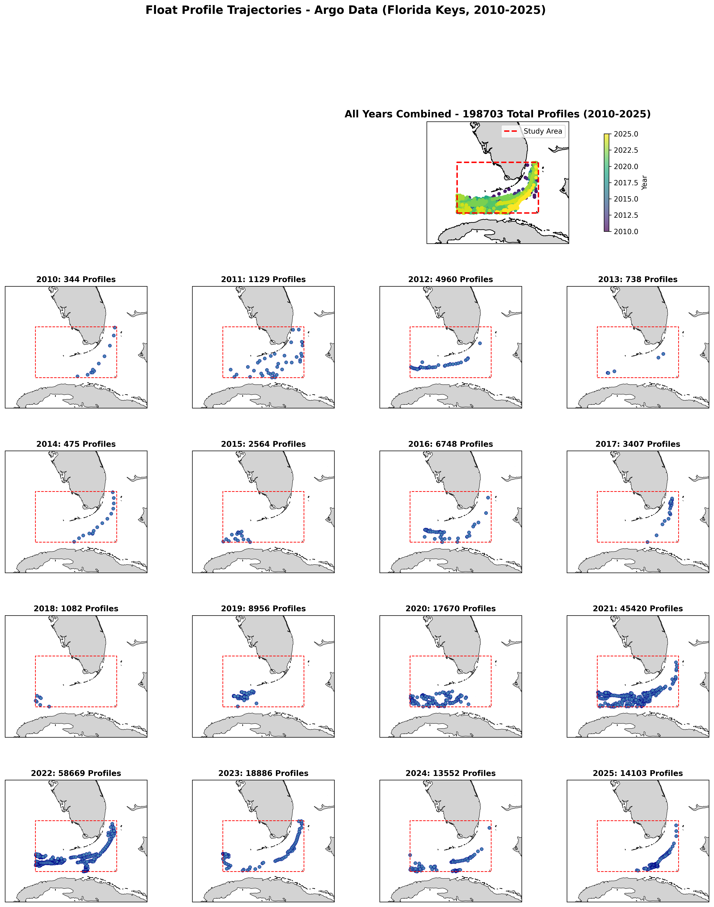
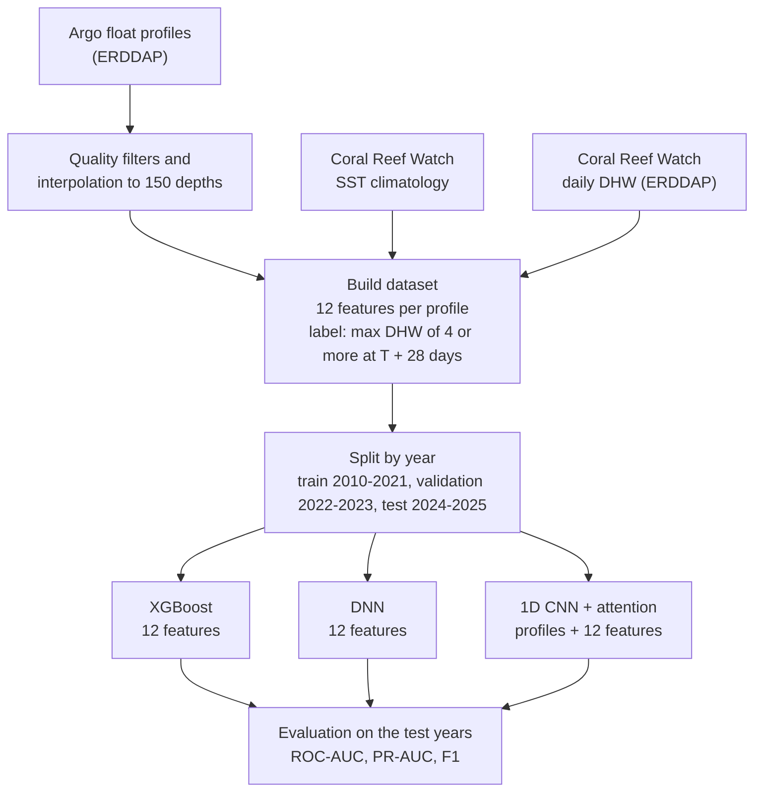
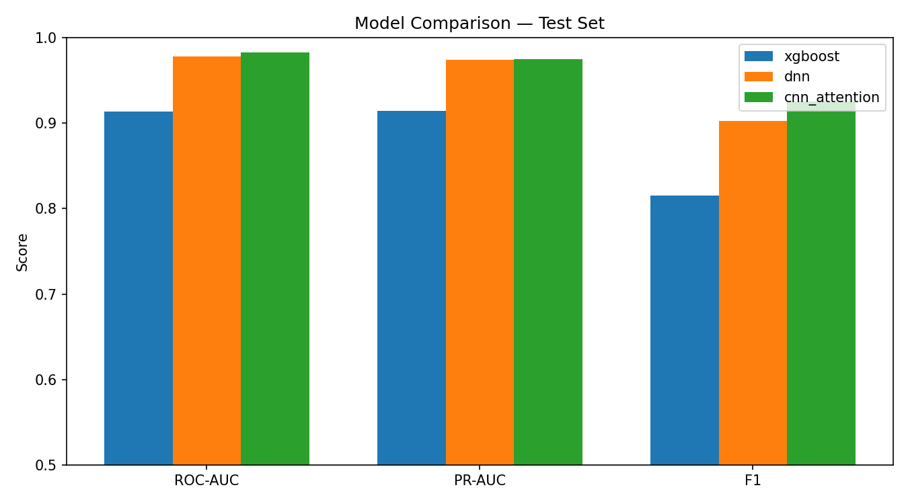

# Coral Bleaching Prediction in the Florida Keys

Predicts, four weeks ahead, whether the Florida Keys will reach bleaching-level heat stress, using temperature and salinity profiles from Argo floats together with NOAA Coral Reef Watch satellite data. Three models are compared: XGBoost, a feed-forward network, and a 1D CNN with attention pooling over depth.

Course project for Big Data Analytics at Worcester Polytechnic Institute.

## Problem

Corals bleach when heat stress builds up over weeks. NOAA Coral Reef Watch measures this as Degree Heating Weeks (DHW); significant bleaching is expected at DHW ≥ 4 °C-weeks. DHW comes from sea-surface temperature only. This project asks whether what is happening below the surface (how deep the warm water goes, how much heat the upper ocean holds) helps predict where DHW will be in four weeks.

**Task:** binary classification. For each Argo profile taken at time T, predict whether the maximum DHW within 1° of the float reaches 4 °C-weeks at T + 28 days (± 7 days).

## Data

| Source | What | Access |
|---|---|---|
| Argo floats | Temperature and salinity profiles, 0 to 300 m, Jan 2010 to Dec 2025, box 23.5–26.0° N, 83.5–79.5° W | `argopy` (ERDDAP) |
| NOAA Coral Reef Watch DHW | Daily 5 km Degree Heating Weeks (`noaacrwdhwDaily`) | CoastWatch ERDDAP |
| NOAA Coral Reef Watch climatology v3.1 | Monthly mean and maximum-monthly-mean (MMM) sea-surface temperature | NOAA STAR |

- 1,331 profiles downloaded; 1,324 kept after quality filters (at least 25 depth levels, reaches 200 m, starts within 50 m of the surface, physical range checks); 1,319 have a label.
- Each profile is interpolated (PCHIP) onto a fixed grid of 150 depths, 2 to 300 m in 2 m steps.
- 28.2 % of profiles are positive (372 of 1,319).



## Method



**Features (12 per profile)**

| Group | Features |
|---|---|
| Surface | `mmm_sst` (climatological maximum), `surface_sst_anom` (anomaly against the monthly mean), `hotspot` (degrees above MMM) |
| Subsurface | `mld` (mixed-layer depth), `ohc_30m` (heat-content proxy for the top 30 m), `hp_depth` (how deep the hotspot reaches) |
| Heat-stress history | `dhw_at_T`, `dhw_lag_7d`, `dhw_lag_14d`, `dhw_lag_28d`, `dhw_delta_1w`, `dhw_delta_4w` |

The CNN also receives the raw temperature and salinity profiles as a 2 × 150 sequence.

**Split by year, to prevent temporal leakage**

| Set | Years | Profiles | Positive |
|---|---|---|---|
| Train | 2010–2021 | 652 | 20.9 % |
| Validation | 2022–2023 | 501 | 34.9 % |
| Test | 2024–2025 | 166 | 36.7 % |

**Models**

- **XGBoost** on the 12 tabular features.
- **DNN**: fully connected layers with batch normalisation and dropout on the same 12 features.
- **CNN + attention**: 1D convolutions over depth, attention pooling that learns which depths matter, concatenated with the 12 tabular features before the classifier.

All three are tuned with Optuna (50 trials, maximising validation PR-AUC), use class weighting for the imbalance, and take their decision threshold from the validation set (best F1). Scalers are fitted on the training set only.

## Results

Held-out test set (2024–2025, 166 profiles):

| Model | ROC-AUC | PR-AUC | F1 | Precision | Recall |
|---|---|---|---|---|---|
| XGBoost | 0.914 | 0.914 | 0.815 | 0.768 | 0.869 |
| DNN | 0.978 | 0.974 | 0.903 | 0.981 | 0.836 |
| **CNN + attention** | **0.982** | **0.975** | **0.926** | 0.933 | **0.918** |



**Ablation (XGBoost): what do the heat-stress history features add?**

| Features | Test ROC-AUC | Test PR-AUC | Test F1 |
|---|---|---|---|
| All 12 | 0.914 | 0.914 | 0.815 |
| Without DHW history (6 surface and subsurface features) | 0.851 | 0.824 | 0.766 |
| DHW history only (6 features) | 0.892 | 0.907 | 0.766 |

## Findings

- The CNN with attention generalises best to the unseen years: 0.982 ROC-AUC and 0.926 F1, with 9 errors in 166 test profiles (4 false positives, 5 false negatives).
- XGBoost matches the neural models on validation (0.962 ROC-AUC) but drops to 0.914 on the test years, so it transfers less well to 2024–2025.
- Heat-stress history carries most of the signal. The five most important XGBoost features are all DHW features (69 % of total importance), and removing them lowers ROC-AUC from 0.914 to 0.851.
- Subsurface structure still helps: the surface and subsurface features alone reach 0.851 ROC-AUC, and adding them to DHW history raises ROC-AUC from 0.892 to 0.914 and F1 from 0.766 to 0.815.

**Limits.** The test set is small (166 profiles, 61 positive). The label and the DHW history features come from the same satellite product, and DHW changes slowly, so part of the skill is persistence. Profiles are sparse before 2019.

## Repository layout

```
getArgoData.py              download and filter Argo profiles
dataPreprocessing.ipynb     cleaning, interpolation, features, labels, split
dhw_prediction/
  main.py                   train and evaluate: --model xgboost | dnn | cnn | all
  compare.py                build the comparison table and chart
  configs/                  model, feature and search settings
  data/processed/           train, validation and test splits
  src/                      models, training loop, Optuna search, metrics, plots
  experiments/              one script per model; runs/ holds metrics, parameters and figures
  results/                  comparison.csv, comparison_bar.png
```

## Run

```bash
pip install -r requirements.txt
pip install torch xgboost optuna scikit-learn imbalanced-learn xarray netCDF4 scipy seaborn

cd dhw_prediction
python main.py --model all             # or xgboost | dnn | cnn
python compare.py
```

Training uses the processed splits in `dhw_prediction/data/processed/`. To rebuild them from raw data, run `getArgoData.py` and then `dataPreprocessing.ipynb`.

Each run writes `metrics.json`, `best_params.json` and ROC, precision-recall and confusion-matrix figures to `experiments/runs/<model>/`.
